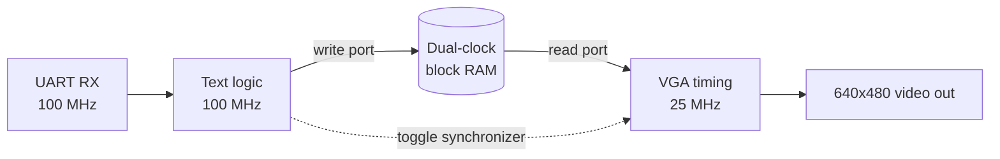

 

---

## About me

I'm a Computer Engineering co-op student at the University of Waterloo. I like digital hardware, especially the parts where you have to prove a design really works. I build small FPGA projects from scratch, measure what they do, and write down how they work.

I'm also a member of **UWASIC**, the UW student chip design team, where I work on digital design in SystemVerilog.

## Right now

- Building on a **Real Digital Blackboard** (AMD Zynq-7007S) with Verilog and Vivado
- Learning formal verification with SystemVerilog assertions and SymbiYosys
- Working as a software engineer co-op at Shoplogix

---

## Featured projects

<table>
<tr>
<td width="33%" valign="top">

### UART to VGA Terminal
[`uart-vga-terminal`](https://github.com/HThakkar23/uart-vga-terminal)

Text terminal with two clock domains.

- 100 MHz UART logic, 25 MHz VGA pixel clock
- 80x30 text at 640x480 using 2 of 50 block RAM tiles
- Baud rate within 0.47% of 115200
- Built-in loopback self-test

</td>
<td width="33%" valign="top">

### Logic Analyzer
[`logic-analyzer`](https://github.com/HThakkar23/logic-analyzer)

8 channels, 100 Sa/s to 100 MSa/s.

- 4096-sample buffer with pre and post trigger
- Binary command protocol over UART
- Full dump measured at 355.6 ms
- Caught an off-by-one in the trigger counter

</td>
<td width="33%" valign="top">

### PDM Audio DSP
[`pdm-audio-dsp`](https://github.com/HThakkar23/pdm-audio-dsp)

Mic to speaker with no codec chip.

- 3rd-order CIC filter, 3.125 MHz PDM to 16-bit audio
- Delta-sigma DAC drives the speaker pin directly
- 101.95 dB calculated SNR
- Python models of every stage

</td>
</tr>
</table>

<b>How the terminal crosses clock domains</b> (click to open)

 

The write side and the read side of the RAM run on different clocks. A toggle synchronizer carries control signals across, so no vendor FIFO or CDC IP is needed.

<b>A bug I found in the logic analyzer</b> (click to open)

 

The post-trigger counter was off by one. It undercounted the trigger window by a single sample and put the ring buffer base address in the wrong place. I found it by tracing a tiny case by hand (depth 8, pre-trigger 4) before trusting the full design, then wrote a testbench that checks that exact case.

---

## Skills

| Area | What I use |
| --- | --- |
| Digital design | FSM design, clock domain crossing, simulation, waveform debugging |
| Interfaces | UART, VGA, PDM audio |
| Signal processing | CIC decimation, delta-sigma, fixed-point sizing |
| Learning now | SVA, SymbiYosys |

---

## GitHub stats

---

